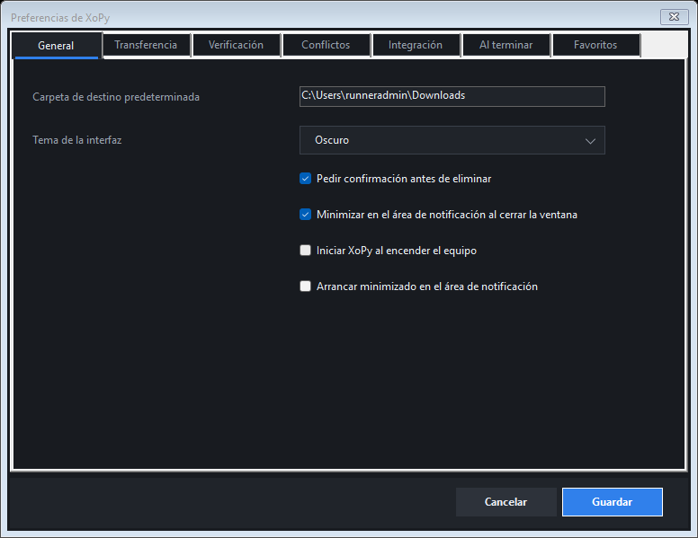
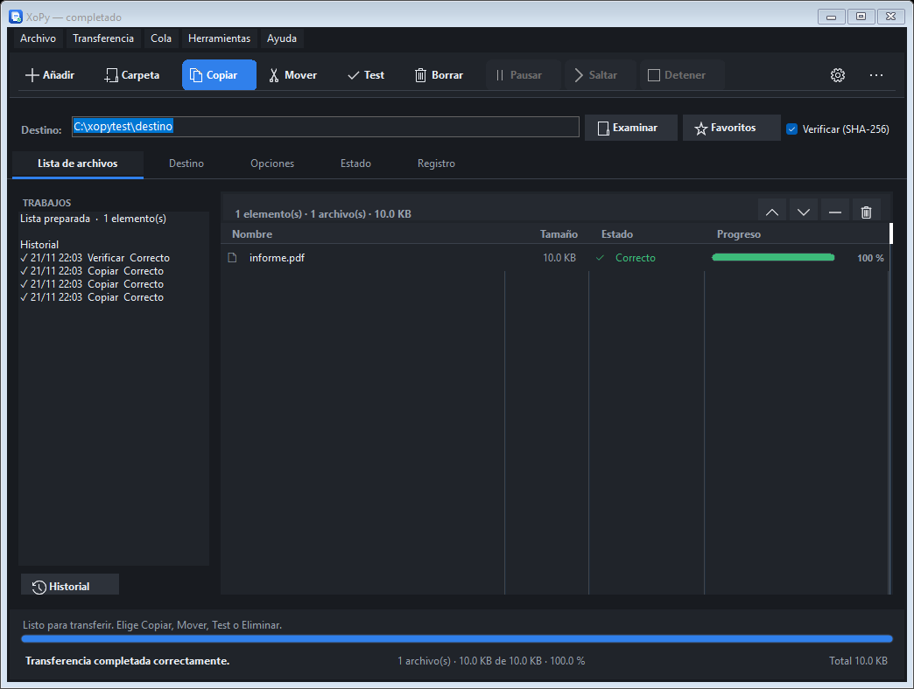

# XoPy


XoPy es un gestor de copias gratuito para **Windows 10/11 de 64 bits**, inspirado en TeraCopy:
misma idea de interfaz compacta, misma forma de trabajar y las mismas opciones que se usan a diario,
pero sin pagos, sin límites de prueba y sin funciones bloqueadas.

## Descargar el instalador

**[XoPy-Setup-win-x64.exe](https://github.com/Quevedo-crack/XoPy/releases/latest/download/XoPy-Setup-win-x64.exe)**

También está disponible la versión portable (un único `.exe`, sin instalar):
<https://github.com/Quevedo-crack/XoPy/releases/latest/download/XoPy.exe>

El instalador es autocontenido: no hace falta tener .NET instalado. Está compilado para
Windows x64 y funciona en Windows 11 (AMD Ryzen, Intel, etc.) sin requisitos adicionales.

Preferencias e integración con el Explorador:



Así se ve una verificación correcta (SHA-256 comparado con el original):



## Automatización y línea de comandos

XoPy acepta órdenes para usarlo desde scripts o desde el Explorador:

```
XoPy.exe --copy  --to "D:\Copias" "C:\Datos\informe.pdf"
XoPy.exe --move  --to "D:\Copias" "C:\Datos\carpeta"
XoPy.exe --test  --to "D:\Copias" "C:\Datos\informe.pdf"
XoPy.exe --copy  --overwrite --verify --algo sha256 --to "D:\Copias" "C:\Datos\informe.pdf"
XoPy.exe --paste --to "D:\Copias"
```

- `--overwrite`, `--skip`, `--rename` fuerzan la política de conflictos de esa ejecución.
- `--verify` y `--algo crc32|md5|sha1|sha256|sha512` activan la verificación al copiar.
- `--ask-destination` abre el selector de carpeta antes de empezar (es lo que hace «Copiar a… con XoPy»).

## Funciones

- **Copia, mueve, elimina y verifica** archivos o carpetas completas (con subcarpetas).
- **Cola jerárquica**: al añadir una carpeta se ve la carpeta y dentro cada archivo. Puedes
  expandirla o contraerla, **cambiar el orden** (botones ↑/↓ o Alt+↑/Alt+↓) y **quitar** elementos
  de la cola antes de transferir.
- **Pausar, reanudar, saltar el archivo actual y detener** en cualquier momento. Los archivos a medio
  copiar se escriben en un temporal `.xopy-part` que se elimina si cancelas; si la carpeta no permite
  crear el temporal (permisos, rutas largas o unidades de red) se copia directamente para no fallar.
- **Verificación real**: CRC32, MD5, SHA-1, SHA-256 y SHA-512, comparando origen y destino.
- **Límite de velocidad**, tamaño de búfer y transferencias simultáneas configurables.
- **Resolución de conflictos**: preguntar, sobrescribir, omitir, cambiar nombre, sobrescribir si
  es más antiguo o si es más pequeño.
- **Gestión de errores**: reintentos automáticos, omitir el archivo o detener la transferencia.
- **Conservar fechas** y atributos, y opción de enviar a la **Papelera de reciclaje**.
- **Favoritos**, historial de transferencias con exportación a CSV y sonido al terminar.
- **Pestañas Lista de archivos / Destino / Opciones / Estado / Registro**, panel de trabajos y hashes
  de origen y destino en la lista.
- **Registro técnico** en `%LOCALAPPDATA%\XoPy\transfer.log` para diagnosticar cualquier error.
- **Acciones al terminar**: apagar el equipo, cerrar XoPy o abrir la carpeta de destino.
- Icono de progreso en el **área de notificación** y modo minimizado.
- Temas **oscuro** y **claro**.

## Integración con el Explorador de Windows

El instalador añade estas acciones al menú contextual (se pueden desactivar en Preferencias):

- **Copiar con XoPy** (usa el último destino configurado)
- **Copiar a… con XoPy** (pregunta la carpeta de destino)
- **Mover con XoPy** / **Mover a… con XoPy**
- **Verificar con XoPy**
- **Pegar con XoPy** y **Abrir XoPy aquí** (en el fondo de una carpeta)
- **Enviar a → Copiar con XoPy / Mover con XoPy** (permite enviar varios archivos a la vez)

En Windows 11 estas acciones aparecen en **Mostrar más opciones** (`Mayús+F10`), igual que en
TeraCopy. Si XoPy ya está abierto, la orden se ejecuta en la ventana existente.

Además XoPy se abre en una sola ventana: si ya está abierto, las nuevas órdenes del Explorador se
añaden a la ventana existente.

> Windows no permite que un programa normal intercepte `Ctrl+C` / `Ctrl+V` del Explorador (eso
> requiere una extensión COM firmada, que es lo que usa TeraCopy). Por eso la integración de XoPy
> se hace con el menú contextual, que es la forma fiable y sin riesgo de romper el sistema.

## Uso rápido

1. Instala XoPy y ábrelo.
2. Añade archivos o carpetas con los botones, con `Ctrl+O`, o arrastrándolos a la ventana.
3. Elige la carpeta de destino en **Copiar a:** (o usa un favorito).
4. Pulsa **Copiar**, **Mover**, **Eliminar** o **Verificar**.
5. Sigue el progreso y la velocidad en la barra inferior. Puedes pausar o detener cuando quieras.

### Atajos de teclado

| Atajo | Acción |
| --- | --- |
| `Ctrl+O` | Añadir archivos |
| `Ctrl+Shift+O` | Añadir carpeta |
| `F5` | Copiar |
| `Ctrl+F5` | Mover |
| `F6` | Verificar |
| `Espacio` | Pausar / reanudar |
| `Esc` | Detener |
| `Supr` | Quitar de la lista |

## Compilar

Requisitos: Windows 10/11 y .NET 8 SDK.

```powershell
dotnet publish .\XoPy\XoPy.csproj -c Release -r win-x64 --self-contained true `
  -p:PublishSingleFile=true -p:IncludeNativeLibrariesForSelfExtract=true -o publish
```

Para generar el instalador, compila `installer\XoPy.iss` con Inno Setup 6:

```powershell
& "$env:ProgramFiles(x86)\Inno Setup 6\ISCC.exe" installer\XoPy.iss
```

El flujo **Build Windows x64** de GitHub Actions hace ambas cosas automáticamente y publica
el instalador como artefacto. Al crear una etiqueta `v*` también se publica en *Releases*.

## Estructura

| Archivo | Contenido |
| --- | --- |
| `XoPy/MainForm.cs` | Ventana principal estilo TeraCopy |
| `XoPy/CopyEngine.cs` | Motor de copia, movimiento, borrado y verificación |
| `XoPy/SettingsStore.cs` | Preferencias e historial en `%LOCALAPPDATA%\XoPy` |
| `XoPy/ShellIntegration.cs` | Menú contextual del Explorador y arranque con Windows |
| `XoPy/Dialogs.cs` | Preferencias, conflictos, errores e historial |
| `installer/XoPy.iss` | Instalador de Inno Setup |
