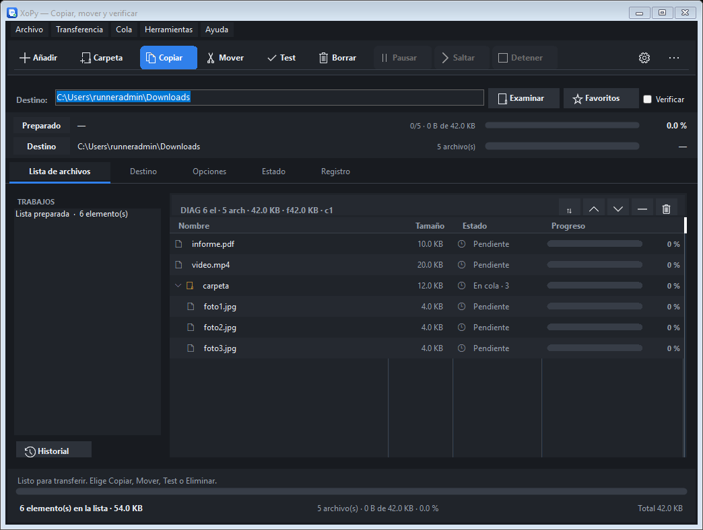
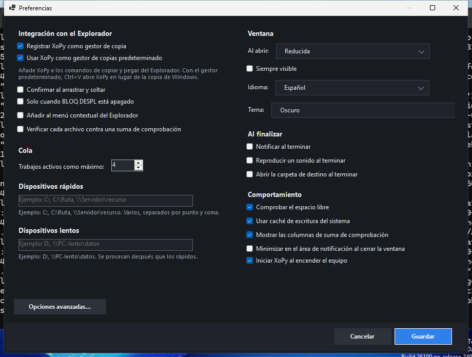

# XoPy



XoPy es un gestor de copias gratuito y sin versiones de pago para **Windows 10/11 de 64 bits**, inspirado en TeraCopy:
misma idea de interfaz compacta, misma forma de trabajar y las mismas opciones que se usan a diario,
pero sin pagos, sin límites de prueba y sin funciones bloqueadas.

## Descargar el instalador

**[XoPy-Setup-win-x64.exe](https://github.com/Quevedo-crack/XoPy/releases/latest/download/XoPy-Setup-win-x64.exe)**

También está disponible la versión portable (un único `.exe`, sin instalar):
<https://github.com/Quevedo-crack/XoPy/releases/latest/download/XoPy.exe>

El instalador es autocontenido: no hace falta tener .NET instalado. Está compilado para
Windows x64 y funciona en Windows 11 (AMD Ryzen, Intel, etc.) sin requisitos adicionales.

Preferencias e integración con el Explorador:



Así se ve una verificación correcta (SHA-256 comparado con el original):


Y el historial, que se puede editar sin tocar los archivos:


## Automatización y línea de comandos

XoPy acepta órdenes para usarlo desde scripts o desde el Explorador:

```
XoPy.exe --copy  --to "D:\Copias" "C:\Datos\informe.pdf"
XoPy.exe --move  --to "D:\Copias" "C:\Datos\carpeta"
XoPy.exe --test  --to "D:\Copias" "C:\Datos\informe.pdf"
XoPy.exe --copy  --overwrite --verify --algo sha256 --to "D:\Copias" "C:\Datos\informe.pdf"
XoPy.exe --paste --to "D:\Copias"
XoPy.exe --copy --engine robocopy --to "D:\Copias" "C:\Datos\carpeta"
XoPy.exe --multi --copy --to "D:\Copias" "C:\Datos\informe.pdf"
```

- `--overwrite`, `--skip`, `--rename` fuerzan la política de conflictos de esa ejecución.
- `--verify` y `--algo crc32|md5|sha1|sha256|sha512` activan la verificación al copiar.
- `--to2 "E:\Espejo"` añade un segundo destino (se puede repetir) y `--checksums` genera el archivo
  de checksums al terminar.
- `--engine native|robocopy|managed` elige el motor de copia solo para esa ejecución.
- `--multi` abre una ventana nueva de XoPy (permite dos copias a la vez).
- `--locked` fuerza la lectura de archivos bloqueados, `--no-resume` desactiva la reanudación y
  `--secure N` sobrescribe N veces antes de borrar. `--script "C:\ruta\tarea.ps1"` se ejecuta al finalizar.
- `--ask-destination` abre el selector de carpeta antes de empezar (es lo que hace «Copiar a… con XoPy»).

## Funciones

- **Copia, mueve, elimina y verifica** archivos o carpetas completas (con subcarpetas).
- **Motor nativo de Windows** (`CopyFileExW` + `CopyProgressRoutine`): la copia la hace el propio
  sistema, con pausa, saltar archivo y límite de velocidad, y sin dobles lecturas. Si algo falla,
  XoPy reintenta con la copia administrada y con permisos de copia de seguridad.
- **Cola jerárquica**: al añadir una carpeta se ve la carpeta y dentro cada archivo, con sus
  subcarpetas. Puedes expandirla o contraerla, **reordenar** (botones ↑/↓ o Alt+↑/Alt+↓) sin separar
  un archivo de su carpeta, **ordenar** por nombre, tamaño, tipo o carpeta de destino (menú Cola o el
  botón ⇅) y **quitar** elementos de la cola antes de transferir.
- **La estructura se conserva**: copiar `C:\Fotos` crea `Destino\Fotos\sub\archivo.jpg`, nunca
  archivos sueltos en la raíz del destino. Las carpetas vacías también se crean.
- **Varios destinos por tarea**: cada archivo se copia a la vez en el destino principal y en los
  destinos adicionales configurados en Opciones.
- **Archivos bloqueados**: se abren con permisos de copia de seguridad (`SeBackupPrivilege`) para
  poder copiar archivos en uso.
- **Reanudar**: si una copia se interrumpe, el siguiente intento continúa desde el byte donde se
  quedó el archivo `.xopy-part`. La cola se guarda sola al cerrar y se puede reabrir desde
  Archivo → «Abrir la última cola y reanudar».
- **Checksums y tareas finales**: genera archivos `.sfv/.md5/.sha1/.sha256/.sha512`, ejecuta un
  script al terminar (PowerShell, BAT o EXE) y permite el borrado seguro con 1–7 pasadas.
- **Informes HTML y CSV** de la transferencia en curso y del historial.
- **Ajustes por defecto para equipos modernos** (4 transferencias simultáneas y búfer de 4 MB,
  pensados para un Ryzen 7 con 24 GB de RAM y NVMe). Todo se puede cambiar en Opciones.
- **Pausar, reanudar, saltar el archivo actual y detener** en cualquier momento. Los archivos a medio
  copiar se escriben en un temporal `.xopy-part` que se elimina si cancelas; si la carpeta no permite
  crear el temporal (permisos, rutas largas o unidades de red) se copia directamente para no fallar.
- **Verificación real**: CRC32, MD5, SHA-1, SHA-256 y SHA-512, comparando origen y destino.
- **Límite de velocidad**, tamaño de búfer y transferencias simultáneas configurables.
- **Resolución de conflictos**: preguntar, sobrescribir, omitir, cambiar nombre, sobrescribir si
  es más antiguo o si es más pequeño.
- **Gestión de errores**: reintentos automáticos, omitir el archivo o detener la transferencia.
- **Conservar fechas** y atributos, y opción de enviar a la **Papelera de reciclaje**.
- **Favoritos**, historial de transferencias con exportación a CSV/HTML y sonido al terminar.
- **Historial editable**: borra una entrada o todo el historial desde el propio diálogo; solo se
  quita el registro, nunca el archivo copiado.
- **Quitar de la lista ≠ borrar**: `Supr` o el botón de la papelera quitan el elemento de la cola
  y no tocan el archivo original. Para borrar de verdad está «Eliminar» y el menú «Eliminar del disco…».
- **Pestañas Lista de archivos / Destino / Opciones / Estado / Registro**, encabezado «Copiando /
  Destino» con porcentaje por archivo, gráfica de velocidad y tabla de categorías (Correctos,
  Verificados, Fallidos, Total). Sin parpadeo: doble búfer y actualizaciones incrementales.
- **Icono de bandeja con el porcentaje** de la copia, como SuperCopier.
- **Registro técnico** en `%LOCALAPPDATA%\XoPy\transfer.log` para diagnosticar cualquier error.
- **Acciones al terminar**: apagar el equipo, cerrar XoPy o abrir la carpeta de destino.
- Icono de progreso en el **área de notificación** y modo minimizado.
- Temas **oscuro** y **claro**.

## Novedades de la versión 2.4.6

- **Corregido el arranque**: el programa ya no falla con error 0xc00000fd (desbordamiento de pila) al abrir, ni en la versión portable ni en la instalada. El hook de pegado de teclado (Ctrl+V) se instala ahora después de que la ventana se muestra, no durante el constructor.
- **Nuevo argumento `--no-shell-hook`**: permite iniciar XoPy sin instalar el hook de teclado, útil para diagnosticar o evitar conflictos en sistemas donde el hook cause problemas.
- Se eliminó la llamada redundante a `ShellIntegration.Cleanup()` al inicio del programa (ya se ejecuta en el formulario principal).
- **Instalador corregido**: `AppId` con llave de cierre completa, `faDirectory` reemplazado por valor numérico, función `RegDeleteKeyIncludingSubkeys` definida y constantes de Inno Setup válidas (`mbYesNo`, `mbIconQuestion`).
- Desinstalación completa opcional que borra `%LOCALAPPDATA%\XoPy` (historial, registros, ajustes).
- Menú contextual «Pegar» funcional mediante la extensión COM x64.
- Estética mejorada del asistente de instalación.

## Novedades de la versión 2.4.1

- XoPy ya no instala acciones con su nombre en el menú contextual ni accesos «Enviar a»; instala una extensión COM x64 con el comando «Pegar» que lanza la operación en XoPy desde el fondo de una carpeta. En Windows 11, las extensiones clásicas pueden aparecer en «Mostrar más opciones».
- Al actualizar, se eliminan las entradas antiguas «Copiar con XoPy», «Mover con XoPy», «Pegar con XoPy», etc.
- La primera apertura tras actualizar se muestra en pantalla y desactiva el ocultamiento heredado en bandeja.
- Si una transferencia encuentra un destino no válido, se puede elegir otra carpeta, crearla, usar la carpeta predeterminada o cancelar.
- En la barra de copia se puede alternar entre modo secuencial y multihilo, también durante una transferencia; un archivo se puede pausar/reanudar individualmente desde el menú contextual de la lista. La lista admite reordenado por arrastre; las carpetas se muestran contraídas al añadirse y se pueden desplegar con la flecha o desde el menú. La columna de trabajos también empieza plegada y puede expandirse.
- El instalador limpia las antiguas claves del menú contextual antes de iniciar la aplicación.

## Novedades de la versión 2.5.9

**Arreglo crítico: el equipo podía quedarse «pensando» y no abrir nada** (ni XoPy, ni el instalador, ni ningún otro programa).

- **Causa**: desde la 2.5.7, el interceptor de Ctrl+V leía el portapapeles **dentro del gancho global de teclado**. Esa rutina la ejecuta Windows dentro de la cola de entrada del sistema, y hablar con el portapapeles desde ahí puede bloquearse esperando al Explorador… que a su vez espera a que el gancho termine. Interbloqueo: teclado y ratón se quedan «pensando» y los dobles clic no llegan a procesarse.
- **Arreglo**: el gancho ahora no hace absolutamente nada lento — solo encola el trabajo y devuelve el control. La lectura del portapapeles vuelve a hacerse en el hilo propio de XoPy.
- **La extensión del menú contextual ya no muestra ningún cuadro de diálogo**: se ejecuta dentro del Explorador y un aviso modal puede dejar el escritorio bloqueado.
- **Fusible automático**: si XoPy no cierra limpiamente con el interceptor puesto dos veces seguidas, la siguiente vez arranca sin él y lo dice. Se reactiva desde Preferencias.
- **Modo seguro**: `XoPy.exe --safe` abre solo la ventana, sin integración con el Explorador ni interceptor.
- **Script de rescate** `RESCATAR-XoPy.bat` (adjunto en la release): cierra XoPy, quita la extensión del menú y el arranque automático y reinicia el Explorador. Funciona aunque el escritorio no responda, lanzándolo desde el Administrador de tareas.

**Prueba nueva en cada compilación**: con el interceptor activo se pulsa Ctrl+V varias veces y se exige que XoPy, el Bloc de notas y la apertura de otras aplicaciones **sigan respondiendo**. Si el sistema se atasca, no se publica la versión.

## Novedades de la versión 2.5.8

**Arreglo urgente: la 2.5.7 podía quedarse sin abrir.** Tres fallos encadenados, los tres corregidos:

- **Al abrir XoPy estando ya en la bandeja, la ventana se mostraba y volvía a esconderse sola.** La lógica de «arrancar en el área de notificación» también se ejecutaba al activar la aplicación, así que el usuario hacía doble clic y no aparecía nada. Ahora esa decisión se toma **una sola vez, al arrancar**; cualquier activación termina siempre con la ventana a la vista.
- **El aviso entre instancias se daba por bueno sin confirmación.** Bastaba con que el mensaje se entregara: si la instancia abierta estaba bloqueada, el proceso nuevo se cerraba creyendo que todo había ido bien. Ahora la instancia abierta **contesta solo cuando la ventana ha atendido la orden**.
- **Una instancia colgada dejaba a XoPy sin poder abrirse nunca más.** Si nadie contestaba, el proceso nuevo se cerraba en silencio. Ahora **abre su propia ventana**: antes una ventana de más que ninguna.

Además:

- **Abrir XoPy a mano muestra siempre la ventana.** La casilla «arrancar minimizado» solo se aplica al inicio con Windows, y su texto ahora lo dice.
- **Si el icono de la bandeja no llega a aparecer, la ventana se queda visible**, para que XoPy no pueda quedar en marcha sin nada a la vista.

**Para que no vuelva a pasar, la compilación ahora ejecuta la aplicación y exige que abra**, en siete situaciones: doble clic; con «arrancar minimizado» guardado; con `--tray` (debe quedarse en la bandeja); abriéndolo otra vez estando en la bandeja; con el bloqueo de instancia ocupado por un proceso que no responde; al actualizar sobre ajustes, historial y cola de una versión anterior; y con los datos de configuración corruptos. La **prueba del instalador deja de ser manual** y se ejecuta en cada compilación: instala en silencio, abre la aplicación instalada, exige ventana visible y desinstala. Si algo de esto falla, **no se publica la versión**.

## Novedades de la versión 2.5.7

- **El instalador ya no cierra el Explorador ni pide reiniciar**: nunca se mata `explorer.exe`, no se relanza una ventana nueva al terminar ni al desinstalar, y se acabó el diálogo «Seleccione acción» (Reintentar / Ignorar). Si la DLL sigue en uso, se sustituye al reiniciar más adelante, sin interrumpir la instalación. El refresco del menú contextual se hace notificando al shell (`SHChangeNotify`), no abriendo el Explorador.
- **Cortar + Ctrl+V funciona**: el efecto «cortar» del portapapeles se lee al interceptar el pegado (antes se leía después y en otro hilo, así que la copia se hacía como copia o no se hacía). Se aceptan las dos formas en que Windows entrega «Preferred DropEffect» (`MemoryStream` y `byte[]`), sin consumir el flujo. El pegado espera a que la lista esté preparada antes de arrancar el motor, y al terminar el movimiento se vacía el portapapeles.
- **«Pegar con XoPy» del menú contextual ya no falla en silencio**: se reconoce el argumento `--replace` que envía la extensión (antes se ignoraba) y, si algo no puede ejecutarse, sale un aviso en vez de no pasar nada.
- **«Enviar a» vuelve a existir**: el arranque lo creaba y lo borraba a la vez (y además quitaba la aprobación de la extensión). Ahora se crea y se conserva, el menú contextual lista también los destinos recientes del historial y «Enviar a» mantiene la estructura de subcarpetas al enviar.
- **Al añadir archivos se pregunta siempre**: «Abrir en una lista nueva» (opción marcada por defecto) o «Añadir a la lista actual». Solo se salta la pregunta si la lista activa está vacía. Antes, con una sola lista, los archivos se apilaban al final sin avisar.
- **Recopiar tras borrar el destino**: si el archivo ya no está en el destino, se vuelve a copiar. El mensaje «ya está copiado» solo sale cuando de verdad sigue estando ahí, y si el origen desapareció se explica con su motivo.
- **Al empezar una copia la ventana pasa sola a su versión reducida**, y si estaba en la bandeja aparece para que se vea el progreso.
- **Cerrar deja de reabrir**: el arranque en la bandeja (`--tray` / «arrancar minimizado») no muestra la ventana ni un instante ni lanza el globo de aviso.
- **Sin saltos en la lista**: al mover, borrar o reordenar se conserva la posición del desplazamiento (antes volvía al principio de la lista).
- **Interfaz sin duplicados** (captura 18): el total de archivos y el tamaño están una sola vez, en la barra de progreso del pie con su resumen; la cabecera de la lista solo cuenta elementos; la cabecera «Copiando» muestra el avance y el tiempo restante, y «Destino» la ruta real de la carpeta en curso.
- **Ventana estable al redimensionar**: los recálculos de columnas y de alto se agrupan (90 ms) en lugar de ejecutarse en cada píxel, que es lo que hacía que la ventana «se volviera loca».
- **Auto-pruebas ampliadas**: `--self-test-repeat` comprueba ahora también «borrar el destino y volver a copiar» (que no aparezca «ya está copiado») y la detección del efecto cortar del portapapeles.

## Novedades de la versión 2.5.6

- **Seguridad al mover (lo más importante de esta versión)**: el original **solo** se borra si la copia de destino existe, tiene el mismo tamaño y (hasta 64 MB) el mismo contenido byte a byte. Si no se puede confirmar, el original se queda y se avisa. Mover a la **misma carpeta** está bloqueado. Las carpetas de origen **nunca** se borran si dentro queda algún archivo o si hubo cualquier error. Antes de mover se guarda `%LOCALAPPDATA%\XoPy\mover-FECHA.txt` con todas las rutas `origen -> destino`, para poder recuperar nada más fallar. Ver `docs/RECUPERAR-ARCHIVOS.md`.
- **«Error» al 0 % en toda la lista** (el fallo de la captura): al volver a pulsar Copiar sobre una lista ya copiada, o después de mover, se volvía a procesar todo y cada archivo acababa en Error porque su origen ya no existía. Ahora lo completado no se reintenta, lo que ya no está en disco se explica con su motivo («El archivo de origen ya no existe…») y las carpetas de otras listas ya no se cuelan en la selección.
- **Mover dentro de la lista**: las flechas ↑/↓ y quitar/vaciar ya no se deshabilitan con una transferencia en curso, así que reordenar funciona siempre (el motor trabaja con su propia copia y la ruta de destino no cambia).
- **Ya no se reabre la ventana**: cerrar con la X cierra de verdad (solo se queda en la bandeja si se marca «Minimizar al cerrar»). «Cerrar al terminar» viene desactivado y, si se activa, deja la ventana visible.
- **Arranque contraído**: la ventana abre en modo reducido y no se vuelve a agrandar al aplicar la posición guardada. Se conserva la posición, no el tamaño de la sesión anterior.
- **Historial de listas ocultable y mostrable** con un botón « en la cabecera de trabajos, con la entrada del menú Ver y con la casilla de Preferencias. El estado se guarda.
- **Multihilo inconfundible**: activado, el botón se pinta con el color de acento y el rayo en blanco; desactivado queda apagado.
- **Porcentaje del icono de la barra de tareas**: se dibuja solo el número, ocupando todo el icono, en lugar de número y «%» diminutos que a 16 px no se leían.
- **Desinstalación sin restos**: el desinstalador cierra XoPy, desregistra la extensión «Pegar», borra `%LOCALAPPDATA%\XoPy` (ajustes, historial, cola y registro) y las claves del registro. El CI comprueba que no queda exe, carpeta, CLSID, menú ni autoarranque.
- **Diagnóstico de errores**: al seleccionar una fila en Error se muestra el motivo completo en la barra de estado (antes solo en el tooltip).
- **Rutas largas**: soporte explícito de rutas de más de 260 caracteres (una de las causas de Error más comunes en TeraCopy).
- **Preferencias**: la casilla «Mostrar la barra de menús superior» existía pero no se mostraba en ninguna página; ahora está, junto a la del historial.
- **Salvaguarda del desinstalador**: si la carpeta de la aplicación no es la de XoPy o está dentro de Escritorio, Documentos, Descargas, Juegos, Series, Música, Imágenes o Vídeos, **no se borra nada**. Para dejar `{app}` vacía, la DLL y el desinstalador bloqueados se mueven a `%TEMP%` antes de borrar.

## Novedades de la versión 2.5.5

- **Instalador**: ya no aparece «DeleteFile falló; código 5». El instalador cierra XoPy, desregistra la extensión, libera la DLL del Explorador (reiniciándolo solo si sigue bloqueada, con reintentos) y, si aun así no puede, la sustituye al reiniciar en vez de abortar.
- **Opciones avanzadas**: ya no da «No se puede agregar 'Button' a 'TabControl'». El botón «← Volver» va donde corresponde.
- **Pegar en el escritorio**: el destino es el escritorio, no la carpeta de origen. Antes salía «origen y destino son el mismo archivo» y usaba la carpeta de copia como destino.
- **Pegar sobre el mismo archivo**: crea una copia con otro nombre (`archivo (1).txt`), sin preguntar y sin tocar el original, como Windows. Antes abría un diálogo por archivo.
- **Multihilo con un solo botón** (icono de rayo): activa o desactiva. El número de hilos se ajusta en Preferencias → Transferencia.
- **Barra de menús oculta** por defecto (opcional en Preferencias): ocupaba una fila entera y todo estaba ya en la barra de iconos.
- **Sin «Eliminar del disco»**: XoPy copia y mueve; para borrar está el Explorador. (La lista se puede vaciar, que no borra archivos.)
- **Barra de progreso visible**: general y de destino, de 16 px y con relleno claro, también en la vista reducida.
- **Resumen sin duplicados**: se quitaron las filas «Origen»/«Destino» repetidas y el «Filtro · Todos los archivos», que no hacía nada.
- **Guarda tamaño y posición** de la ventana (antes se recortaba a 1080×660) y conserva el maximizado.
- **Lista con la ruta completa**: al arrastrar una carpeta se añade cada archivo con su raíz y subcarpetas, y se reordena sin perder la ruta.

## Novedades de la versión 2.5.4

- **Instalador arreglado**: ya no falla con «DeleteFile falló; código 5». Antes de copiar archivos se desregistra la extensión y se libera la DLL del Explorador (reiniciándolo solo si sigue bloqueada), y XoPy se cierra solo durante la instalación.
- **«Pegar» en todos los contextos**: fondo de carpeta, sobre una carpeta **y escritorio**. Antes solo estaba en el fondo de carpeta, por eso al pegar en el escritorio seguía copiando Windows. El registro se completa siempre y se avisa al shell.
- **Lista plana, como TeraCopy**: una fila por archivo, venga de la carpeta que venga, siempre con su **ruta completa (raíz incluida)**. Se reordena archivo a archivo con los botones ↑/↓ y la ruta de destino no cambia.
- **Reordenar con los botones funciona de verdad**: antes solo se intercambiaban archivos de la misma carpeta y casi siempre respondía «ya está en el extremo».
- **Icono de la bandeja → ventana al frente**: se usa `AttachThreadInput`, que sí funciona aunque el clic lo haya recibido el área de notificación.
- **Una sola ventana**: una segunda instancia ya no abre otra ventana; se reenvía a la que está abierta y, si no responde, se sale.
- **Maximizado se conserva** al reabrir desde la bandeja.
- **Cerrar con la X deja XoPy en la bandeja** mientras sustituye al copiador, avisando la primera vez (para cerrarlo del todo: icono → Salir).
- **Pruebas automáticas**: copia real de 200 MB (81,6 MB/s con hash correcto) y 300 archivos (81 archivos/s), reordenación entre raíces distintas, botones ↑/↓ reales y edición de la lista.

## Novedades de la versión 2.5.3

- **Integración real con el Explorador**: la DLL registra ahora su servidor COM (`DllRegisterServer`/`DllUnregisterServer`), de modo que «Pegar» sustituye de verdad al copiador de Windows.
- **Modo de ventana**: «Al abrir» → reducida (por defecto), completa o automático; la ventana recuerda el tamaño elegido y se puede redimensionar.
- **Icono de bandeja**: al pulsarlo, la ventana siempre aparece delante y restaurada.
- **Un solo engranaje**: el menú «⋯» duplicaba «Preferencias» y se ha retirado.
- **Pausar / Reanudar / Detener** siempre visibles, también en vista reducida.
- **Renombrar y reordenar** mientras la copia sigue en marcha, sin tocar la ruta de destino.
- **Ruta completa** en la columna Nombre, con la carpeta atenuada, como TeraCopy.

## Novedades de la versión 2.5.2

- **La integración con Windows sustituye de verdad el copiador**: el instalador registra la
  extensión «Pegar» y XoPy ya no la borra al arrancar (antes se eliminaba la clave y por eso
  Ctrl+V seguía siendo el de Windows).
- **Al terminar una copia la ventana se cierra, pero XoPy sigue funcionando** en la bandeja
  para las próximas copias (antes se cerraba la aplicación entera).
- **Vista reducida como TeraCopy**: la ventana se ajusta a su contenido en vez de recortarse y
  los botones de pausar, reanudar y detener siguen visibles.
- **Sin destino heredado**: la carpeta de destino ya no se rellena sola al arrancar.
- **Menú de los tres puntos**: solo «Preferencias…»; se quitó el selector «Lista de copia».
- **Sin espacio en el destino**: se puede continuar, copiar solo lo que quepa o cancelar.
- **Lista editable**: renombrar cualquier elemento con F2 o desde el menú contextual.
- **Pausa y reanudación rápidas**: al reanudar ya no se arrastra el tiempo en pausa en el
  cálculo del límite de velocidad («copiaba superlento»).
- **Porcentaje de la barra de tareas** dibujado a 64 px: el número se lee bien con escalado.
- **Instalador**: copia y registra `XoPyShell.dll` (sin ella el comando «Pegar» no existía).

## Novedades de la versión 2.5.1

- **Preferencias estilo TeraCopy 4**: una sola pantalla en dos columnas, con las secciones
  *Integración con el Explorador*, *Cola*, *Ventana*, *Al finalizar* y *Comportamiento*, y los
  botones **Guardar/Cancelar** abajo a la derecha. Todo el texto está en español.
- **La ventana abre con la lista visible** a 940×600 (antes arrancaba recortada) y la columna
  de archivos se reparte al ancho real, sin franjas claras.
- **Reordenar mientras copia**: se puede mover, arrastrar entre subcarpetas y ordenar la cola
  (incluido el orden global por tamaño) con la transferencia en marcha o en pausa.
- **El destino nunca viene prefijado**: al añadir archivos se pregunta siempre la carpeta.
- **Varios destinos a la vez** (`--to2`): un fallo en un destino ya no cancela los demás, y
  `--exit` espera a que terminen todos antes de cerrar.
- **Comprobaciones automáticas en CI**: el workflow *UI preview* ejecuta copia, conflicto,
  verificación, movimiento, Robocopy, jerarquía con varios destinos, reanudación y una prueba
  de la cola (`--self-test-queue`), y regenera las capturas de esta página.

## Novedades de la versión 2.4.0

- **Pegado con teclado en el Explorador**: `Ctrl+V` se intercepta cuando el portapapeles contiene archivos y se usa XoPy; si venías de «Cortar», se mueven y se eliminan del origen. Se puede desactivar en Preferencias → Integración.
- **Ya no aparece en «Enviar a»**: el pegado con teclado es la forma de usarlo.
- **Motor elegible**: Nativo (CopyFileEx), **Robocopy** o Administrado, en Preferencias → Transferencia.
- **Mover borra siempre el origen**, incluidos los archivos y las carpetas que quedan vacías.
- **Tiempo estimado** en la barra de título, en el encabezado y en el pie.
- **En pausa la velocidad es 0 B/s**.
- **Porcentaje más grande** en el icono de la bandeja y en el botón de la barra de tareas, con barra de progreso propia.
- **Clic izquierdo en el icono de la bandeja abre la ventana**.
- **Nueva copia con otra en curso**: XoPy pregunta si añadirla a la actual o abrir otra ventana.
- **Columna de trabajos plegable**, orden por origen/destino/tamaño/tipo/nombre/estado y reinicio como administrador.

## Integración con el Explorador de Windows

XoPy no añade opciones con su nombre al menú contextual ni a «Enviar a». El hook sustituye `Ctrl+V`
cuando el portapapeles contiene archivos; además, la extensión COM x64 aporta un comando llamado
«Pegar» en el fondo de las carpetas y lanza XoPy con el destino de esa carpeta. Si ya está abierto,
la transferencia se incorpora a la ventana existente. En Windows 11 el comando puede aparecer en
«Mostrar más opciones». La opción nativa que aporta Windows sigue siendo del sistema; la extensión
no modifica ni elimina componentes de Windows.

## Uso rápido

1. Instala XoPy y ábrelo.
2. Añade archivos o carpetas con los botones, con `Ctrl+O`, o arrastrándolos a la ventana.
3. Elige la carpeta de destino en **Copiar a:** (o usa un favorito).
4. Pulsa **Copiar**, **Mover**, **Eliminar** o **Verificar**.
5. Sigue el progreso y la velocidad en la barra inferior. Puedes pausar o detener cuando quieras.

### Atajos de teclado

| Atajo | Acción |
| --- | --- |
| `Ctrl+O` | Añadir archivos |
| `Ctrl+Shift+O` | Añadir carpeta |
| `F5` | Copiar |
| `Ctrl+F5` | Mover |
| `F6` | Verificar |
| `Espacio` | Pausar / reanudar |
| `Esc` | Detener |
| `Supr` | Quitar de la lista |

## Compilar

Requisitos para compilar desde el código fuente: Windows 10/11 y .NET 10 SDK. El instalador publicado incluye el runtime y no requiere instalar .NET por separado.

```powershell
dotnet publish .\XoPy\XoPy.csproj -c Release -r win-x64 --self-contained true `
  -p:PublishSingleFile=true -p:IncludeNativeLibrariesForSelfExtract=true -o publish
```

Para generar el instalador, compila `installer\XoPy.iss` con Inno Setup 6:

```powershell
& "$env:ProgramFiles(x86)\Inno Setup 6\ISCC.exe" installer\XoPy.iss
```

El flujo **Build Windows x64** de GitHub Actions hace ambas cosas automáticamente y publica
el instalador como artefacto. Al crear una etiqueta `v*` también se publica en *Releases*.

## Estructura

| Archivo | Contenido |
| --- | --- |
| `XoPy/MainForm.cs` | Ventana principal estilo TeraCopy |
| `XoPy/CopyEngine.cs` | Motor de copia, movimiento, borrado y verificación |
| `XoPy/SettingsStore.cs` | Preferencias e historial en `%LOCALAPPDATA%\XoPy` |
| `XoPy/ShellIntegration.cs` | Menú contextual del Explorador y arranque con Windows |
| `XoPy/Dialogs.cs` | Preferencias, conflictos, errores e historial |
| `installer/XoPy.iss` | Instalador de Inno Setup |
