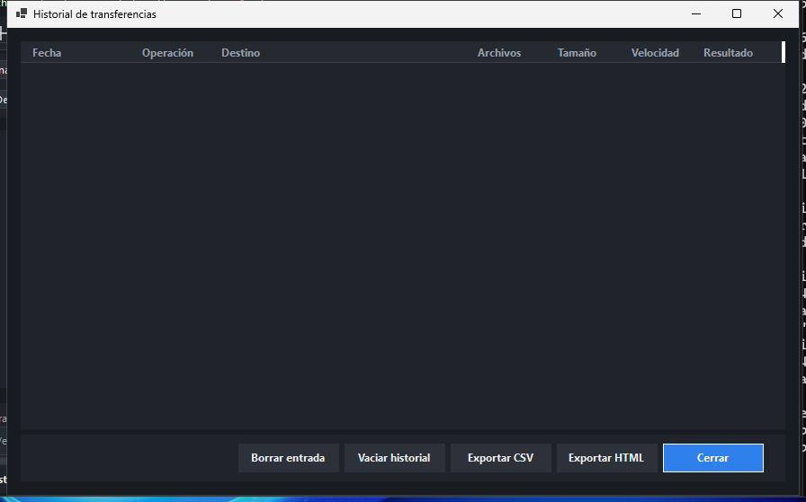

# XoPy


XoPy es un gestor de copias gratuito y sin versiones de pago para **Windows 10/11 de 64 bits**, inspirado en TeraCopy:
misma idea de interfaz compacta, misma forma de trabajar y las mismas opciones que se usan a diario,
pero sin pagos, sin límites de prueba y sin funciones bloqueadas.

## Descargar el instalador

**[XoPy-Setup-win-x64.exe](https://github.com/Quevedo-crack/XoPy/releases/latest/download/XoPy-Setup-win-x64.exe)**

También está disponible la versión portable (un único `.exe`, sin instalar):
<https://github.com/Quevedo-crack/XoPy/releases/latest/download/XoPy.exe>

El instalador es autocontenido: no hace falta tener .NET instalado. Está compilado para
Windows x64 y funciona en Windows 11 (AMD Ryzen, Intel, etc.) sin requisitos adicionales.

Preferencias e integración con el Explorador:


Así se ve una verificación correcta (SHA-256 comparado con el original):


Y el historial, que se puede editar sin tocar los archivos:



## Automatización y línea de comandos

XoPy acepta órdenes para usarlo desde scripts o desde el Explorador:

```
XoPy.exe --copy  --to "D:\Copias" "C:\Datos\informe.pdf"
XoPy.exe --move  --to "D:\Copias" "C:\Datos\carpeta"
XoPy.exe --test  --to "D:\Copias" "C:\Datos\informe.pdf"
XoPy.exe --copy  --overwrite --verify --algo sha256 --to "D:\Copias" "C:\Datos\informe.pdf"
XoPy.exe --paste --to "D:\Copias"
XoPy.exe --copy --engine robocopy --to "D:\Copias" "C:\Datos\carpeta"
XoPy.exe --multi --copy --to "D:\Copias" "C:\Datos\informe.pdf"
```

- `--overwrite`, `--skip`, `--rename` fuerzan la política de conflictos de esa ejecución.
- `--verify` y `--algo crc32|md5|sha1|sha256|sha512` activan la verificación al copiar.
- `--to2 "E:\Espejo"` añade un segundo destino (se puede repetir) y `--checksums` genera el archivo
  de checksums al terminar.
- `--engine native|robocopy|managed` elige el motor de copia solo para esa ejecución.
- `--multi` abre una ventana nueva de XoPy (permite dos copias a la vez).
- `--locked` fuerza la lectura de archivos bloqueados, `--no-resume` desactiva la reanudación y
  `--secure N` sobrescribe N veces antes de borrar. `--script "C:\ruta\tarea.ps1"` se ejecuta al finalizar.
- `--ask-destination` abre el selector de carpeta antes de empezar (es lo que hace «Copiar a… con XoPy»).

## Funciones

- **Copia, mueve, elimina y verifica** archivos o carpetas completas (con subcarpetas).
- **Motor nativo de Windows** (`CopyFileExW` + `CopyProgressRoutine`): la copia la hace el propio
  sistema, con pausa, saltar archivo y límite de velocidad, y sin dobles lecturas. Si algo falla,
  XoPy reintenta con la copia administrada y con permisos de copia de seguridad.
- **Cola jerárquica**: al añadir una carpeta se ve la carpeta y dentro cada archivo, con sus
  subcarpetas. Puedes expandirla o contraerla, **reordenar** (botones ↑/↓ o Alt+↑/Alt+↓) sin separar
  un archivo de su carpeta, **ordenar** por nombre, tamaño, tipo o carpeta de destino (menú Cola o el
  botón ⇅) y **quitar** elementos de la cola antes de transferir.
- **La estructura se conserva**: copiar `C:\Fotos` crea `Destino\Fotos\sub\archivo.jpg`, nunca
  archivos sueltos en la raíz del destino. Las carpetas vacías también se crean.
- **Varios destinos por tarea**: cada archivo se copia a la vez en el destino principal y en los
  destinos adicionales configurados en Opciones.
- **Archivos bloqueados**: se abren con permisos de copia de seguridad (`SeBackupPrivilege`) para
  poder copiar archivos en uso.
- **Reanudar**: si una copia se interrumpe, el siguiente intento continúa desde el byte donde se
  quedó el archivo `.xopy-part`. La cola se guarda sola al cerrar y se puede reabrir desde
  Archivo → «Abrir la última cola y reanudar».
- **Checksums y tareas finales**: genera archivos `.sfv/.md5/.sha1/.sha256/.sha512`, ejecuta un
  script al terminar (PowerShell, BAT o EXE) y permite el borrado seguro con 1–7 pasadas.
- **Informes HTML y CSV** de la transferencia en curso y del historial.
- **Ajustes por defecto para equipos modernos** (4 transferencias simultáneas y búfer de 4 MB,
  pensados para un Ryzen 7 con 24 GB de RAM y NVMe). Todo se puede cambiar en Opciones.
- **Pausar, reanudar, saltar el archivo actual y detener** en cualquier momento. Los archivos a medio
  copiar se escriben en un temporal `.xopy-part` que se elimina si cancelas; si la carpeta no permite
  crear el temporal (permisos, rutas largas o unidades de red) se copia directamente para no fallar.
- **Verificación real**: CRC32, MD5, SHA-1, SHA-256 y SHA-512, comparando origen y destino.
- **Límite de velocidad**, tamaño de búfer y transferencias simultáneas configurables.
- **Resolución de conflictos**: preguntar, sobrescribir, omitir, cambiar nombre, sobrescribir si
  es más antiguo o si es más pequeño.
- **Gestión de errores**: reintentos automáticos, omitir el archivo o detener la transferencia.
- **Conservar fechas** y atributos, y opción de enviar a la **Papelera de reciclaje**.
- **Favoritos**, historial de transferencias con exportación a CSV/HTML y sonido al terminar.
- **Historial editable**: borra una entrada o todo el historial desde el propio diálogo; solo se
  quita el registro, nunca el archivo copiado.
- **Quitar de la lista ≠ borrar**: `Supr` o el botón de la papelera quitan el elemento de la cola
  y no tocan el archivo original. Para borrar de verdad está «Eliminar» y el menú «Eliminar del disco…».
- **Pestañas Lista de archivos / Destino / Opciones / Estado / Registro**, encabezado «Copiando /
  Destino» con porcentaje por archivo, gráfica de velocidad y tabla de categorías (Correctos,
  Verificados, Fallidos, Total). Sin parpadeo: doble búfer y actualizaciones incrementales.
- **Icono de bandeja con el porcentaje** de la copia, como SuperCopier.
- **Registro técnico** en `%LOCALAPPDATA%\XoPy\transfer.log` para diagnosticar cualquier error.
- **Acciones al terminar**: apagar el equipo, cerrar XoPy o abrir la carpeta de destino.
- Icono de progreso en el **área de notificación** y modo minimizado.
- Temas **oscuro** y **claro**.

## Novedades de la versión 2.4.6

- **Corregido el arranque**: el programa ya no falla con error 0xc00000fd (desbordamiento de pila) al abrir, ni en la versión portable ni en la instalada. El hook de pegado de teclado (Ctrl+V) se instala ahora después de que la ventana se muestra, no durante el constructor.
- **Nuevo argumento `--no-shell-hook`**: permite iniciar XoPy sin instalar el hook de teclado, útil para diagnosticar o evitar conflictos en sistemas donde el hook cause problemas.
- Se eliminó la llamada redundante a `ShellIntegration.Cleanup()` al inicio del programa (ya se ejecuta en el formulario principal).
- **Instalador corregido**: `AppId` con llave de cierre completa, `faDirectory` reemplazado por valor numérico, función `RegDeleteKeyIncludingSubkeys` definida y constantes de Inno Setup válidas (`mbYesNo`, `mbIconQuestion`).
- Desinstalación completa opcional que borra `%LOCALAPPDATA%\XoPy` (historial, registros, ajustes).
- Menú contextual «Pegar» funcional mediante la extensión COM x64.
- Estética mejorada del asistente de instalación.

## Novedades de la versión 2.4.1

- XoPy ya no instala acciones con su nombre en el menú contextual ni accesos «Enviar a»; instala una extensión COM x64 con el comando «Pegar» que lanza la operación en XoPy desde el fondo de una carpeta. En Windows 11, las extensiones clásicas pueden aparecer en «Mostrar más opciones».
- Al actualizar, se eliminan las entradas antiguas «Copiar con XoPy», «Mover con XoPy», «Pegar con XoPy», etc.
- La primera apertura tras actualizar se muestra en pantalla y desactiva el ocultamiento heredado en bandeja.
- Si una transferencia encuentra un destino no válido, se puede elegir otra carpeta, crearla, usar la carpeta predeterminada o cancelar.
- En la barra de copia se puede alternar entre modo secuencial y multihilo, también durante una transferencia; un archivo se puede pausar/reanudar individualmente desde el menú contextual de la lista. La lista admite reordenado por arrastre; las carpetas se muestran contraídas al añadirse y se pueden desplegar con la flecha o desde el menú. La columna de trabajos también empieza plegada y puede expandirse.
- El instalador limpia las antiguas claves del menú contextual antes de iniciar la aplicación.

## Novedades de la versión 2.5.3

- **Integración real con el Explorador**: la DLL registra ahora su servidor COM (`DllRegisterServer`/`DllUnregisterServer`), de modo que «Pegar» sustituye de verdad al copiador de Windows.
- **Modo de ventana**: «Al abrir» → reducida (por defecto), completa o automático; la ventana recuerda el tamaño elegido y se puede redimensionar.
- **Icono de bandeja**: al pulsarlo, la ventana siempre aparece delante y restaurada.
- **Un solo engranaje**: el menú «⋯» duplicaba «Preferencias» y se ha retirado.
- **Pausar / Reanudar / Detener** siempre visibles, también en vista reducida.
- **Renombrar y reordenar** mientras la copia sigue en marcha, sin tocar la ruta de destino.
- **Ruta completa** en la columna Nombre, con la carpeta atenuada, como TeraCopy.

## Novedades de la versión 2.5.2

- **La integración con Windows sustituye de verdad el copiador**: el instalador registra la
  extensión «Pegar» y XoPy ya no la borra al arrancar (antes se eliminaba la clave y por eso
  Ctrl+V seguía siendo el de Windows).
- **Al terminar una copia la ventana se cierra, pero XoPy sigue funcionando** en la bandeja
  para las próximas copias (antes se cerraba la aplicación entera).
- **Vista reducida como TeraCopy**: la ventana se ajusta a su contenido en vez de recortarse y
  los botones de pausar, reanudar y detener siguen visibles.
- **Sin destino heredado**: la carpeta de destino ya no se rellena sola al arrancar.
- **Menú de los tres puntos**: solo «Preferencias…»; se quitó el selector «Lista de copia».
- **Sin espacio en el destino**: se puede continuar, copiar solo lo que quepa o cancelar.
- **Lista editable**: renombrar cualquier elemento con F2 o desde el menú contextual.
- **Pausa y reanudación rápidas**: al reanudar ya no se arrastra el tiempo en pausa en el
  cálculo del límite de velocidad («copiaba superlento»).
- **Porcentaje de la barra de tareas** dibujado a 64 px: el número se lee bien con escalado.
- **Instalador**: copia y registra `XoPyShell.dll` (sin ella el comando «Pegar» no existía).

## Novedades de la versión 2.5.1

- **Preferencias estilo TeraCopy 4**: una sola pantalla en dos columnas, con las secciones
  *Integración con el Explorador*, *Cola*, *Ventana*, *Al finalizar* y *Comportamiento*, y los
  botones **Guardar/Cancelar** abajo a la derecha. Todo el texto está en español.
- **La ventana abre con la lista visible** a 940×600 (antes arrancaba recortada) y la columna
  de archivos se reparte al ancho real, sin franjas claras.
- **Reordenar mientras copia**: se puede mover, arrastrar entre subcarpetas y ordenar la cola
  (incluido el orden global por tamaño) con la transferencia en marcha o en pausa.
- **El destino nunca viene prefijado**: al añadir archivos se pregunta siempre la carpeta.
- **Varios destinos a la vez** (`--to2`): un fallo en un destino ya no cancela los demás, y
  `--exit` espera a que terminen todos antes de cerrar.
- **Comprobaciones automáticas en CI**: el workflow *UI preview* ejecuta copia, conflicto,
  verificación, movimiento, Robocopy, jerarquía con varios destinos, reanudación y una prueba
  de la cola (`--self-test-queue`), y regenera las capturas de esta página.

## Novedades de la versión 2.4.0

- **Pegado con teclado en el Explorador**: `Ctrl+V` se intercepta cuando el portapapeles contiene archivos y se usa XoPy; si venías de «Cortar», se mueven y se eliminan del origen. Se puede desactivar en Preferencias → Integración.
- **Ya no aparece en «Enviar a»**: el pegado con teclado es la forma de usarlo.
- **Motor elegible**: Nativo (CopyFileEx), **Robocopy** o Administrado, en Preferencias → Transferencia.
- **Mover borra siempre el origen**, incluidos los archivos y las carpetas que quedan vacías.
- **Tiempo estimado** en la barra de título, en el encabezado y en el pie.
- **En pausa la velocidad es 0 B/s**.
- **Porcentaje más grande** en el icono de la bandeja y en el botón de la barra de tareas, con barra de progreso propia.
- **Clic izquierdo en el icono de la bandeja abre la ventana**.
- **Nueva copia con otra en curso**: XoPy pregunta si añadirla a la actual o abrir otra ventana.
- **Columna de trabajos plegable**, orden por origen/destino/tamaño/tipo/nombre/estado y reinicio como administrador.

## Integración con el Explorador de Windows

XoPy no añade opciones con su nombre al menú contextual ni a «Enviar a». El hook sustituye `Ctrl+V`
cuando el portapapeles contiene archivos; además, la extensión COM x64 aporta un comando llamado
«Pegar» en el fondo de las carpetas y lanza XoPy con el destino de esa carpeta. Si ya está abierto,
la transferencia se incorpora a la ventana existente. En Windows 11 el comando puede aparecer en
«Mostrar más opciones». La opción nativa que aporta Windows sigue siendo del sistema; la extensión
no modifica ni elimina componentes de Windows.

## Uso rápido

1. Instala XoPy y ábrelo.
2. Añade archivos o carpetas con los botones, con `Ctrl+O`, o arrastrándolos a la ventana.
3. Elige la carpeta de destino en **Copiar a:** (o usa un favorito).
4. Pulsa **Copiar**, **Mover**, **Eliminar** o **Verificar**.
5. Sigue el progreso y la velocidad en la barra inferior. Puedes pausar o detener cuando quieras.

### Atajos de teclado

| Atajo | Acción |
| --- | --- |
| `Ctrl+O` | Añadir archivos |
| `Ctrl+Shift+O` | Añadir carpeta |
| `F5` | Copiar |
| `Ctrl+F5` | Mover |
| `F6` | Verificar |
| `Espacio` | Pausar / reanudar |
| `Esc` | Detener |
| `Supr` | Quitar de la lista |

## Compilar

Requisitos para compilar desde el código fuente: Windows 10/11 y .NET 10 SDK. El instalador publicado incluye el runtime y no requiere instalar .NET por separado.

```powershell
dotnet publish .\XoPy\XoPy.csproj -c Release -r win-x64 --self-contained true `
  -p:PublishSingleFile=true -p:IncludeNativeLibrariesForSelfExtract=true -o publish
```

Para generar el instalador, compila `installer\XoPy.iss` con Inno Setup 6:

```powershell
& "$env:ProgramFiles(x86)\Inno Setup 6\ISCC.exe" installer\XoPy.iss
```

El flujo **Build Windows x64** de GitHub Actions hace ambas cosas automáticamente y publica
el instalador como artefacto. Al crear una etiqueta `v*` también se publica en *Releases*.

## Estructura

| Archivo | Contenido |
| --- | --- |
| `XoPy/MainForm.cs` | Ventana principal estilo TeraCopy |
| `XoPy/CopyEngine.cs` | Motor de copia, movimiento, borrado y verificación |
| `XoPy/SettingsStore.cs` | Preferencias e historial en `%LOCALAPPDATA%\XoPy` |
| `XoPy/ShellIntegration.cs` | Menú contextual del Explorador y arranque con Windows |
| `XoPy/Dialogs.cs` | Preferencias, conflictos, errores e historial |
| `installer/XoPy.iss` | Instalador de Inno Setup |
